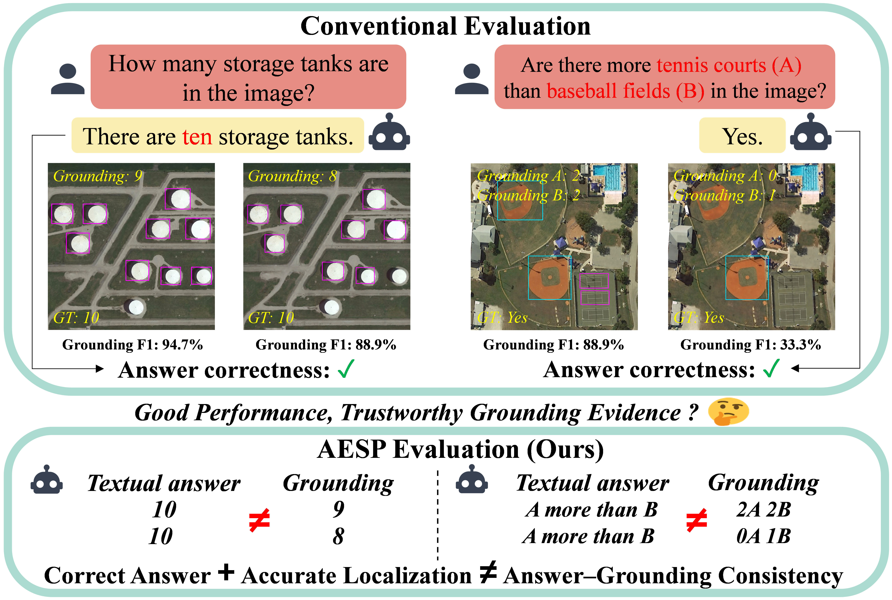

# AESP: Answer-Evidence Support Protocol

**Benchmarking answer-grounding consistency in remote sensing visual question answering.**

## Motivation

### Grounding as visual evidence

Visual grounding connects language to specific regions in an image. In grounded visual question answering, a vision-language model (VLM) returns these regions alongside its answer as visual evidence. Users can then inspect the objects presented as support for the model's response.

For grounding to serve this purpose, **the returned evidence should support what the model says.**

### When the evidence does not support the answer

A model can answer correctly and localize relevant objects accurately, yet return evidence that fails to support its answer. Our counting and comparison examples illustrate this problem.



*Figure 1. Correct answers and high localization scores do not guarantee answer-grounding consistency.*

| Task | Model's answer | Returned evidence | Grounding F1 |
| --- | --- | --- | --- |
| Counting | There are **10 storage tanks**. | Only **9 storage tanks** are covered. | **94.7%** |
| Comparison | There are **more tennis courts than baseball fields**. | **2 tennis courts and 2 baseball fields** are covered. | **88.9%** |

Both answers are correct. However, nine grounded tanks do not establish a count of ten, and equal grounded counts do not establish “more than.”

> **Relevant objects do not necessarily provide sufficient evidence for the answer.**

### What standard metrics miss

Answer accuracy and localization quality assess different parts of a grounded response. Neither directly checks the logical relationship between them.

| Evaluation dimension | Question being evaluated |
| --- | --- |
| **Answer accuracy** | Does the model's answer match the reference answer? |
| **Localization quality** | Do the predicted regions match the annotated object locations? |
| **Evidence support — AESP** | Do the objects covered by the predicted regions support the model's own answer? |

The third question cannot be answered simply by reporting high scores on the first two.

### From grounding to trustworthy answers

This gap affects the trustworthiness of grounded VLM responses. Users expect the returned regions to provide evidence for the answer. If the objects in those regions do not support what the model says, the grounding cannot serve as reliable evidence.

We introduce **AESP (Answer-Evidence Support Protocol)** to explicitly evaluate this connection in remote sensing VQA. AESP identifies annotated target objects covered by the predicted evidence regions and checks whether they support the model's answer under task-specific rules:

- **Existence:** whether the covered objects support the stated presence.
- **Counting:** whether the covered objects support the stated count.
- **Comparison:** whether the covered objects support the stated numerical relationship.

Evaluated alongside answer accuracy and localization quality, AESP distinguishes correct answers with supporting evidence from correct answers with unsupported claims and assesses the evidence that the model presents to users.


## Benchmark

**GroundedRSVQA** (G-RSVQA) contains **15,027 remote sensing images**, with one question per image and **163,399 relevant ground-truth object annotations**. Each sample includes a question, a reference answer, and the annotated objects needed to evaluate the answer and its visual evidence.

### Data composition

The benchmark is built from three object detection datasets:

| Source dataset | Images / QA pairs | Official source |
| --- | ---: | --- |
| DIOR | 11,714 | [Dataset page](https://gcheng-nwpu.github.io/#Datasets) |
| NWPU VHR-10 | 800 | [Dataset page](https://gcheng-nwpu.github.io/#Datasets) |
| SODA-A | 2,513 | [Project page](https://shaunyuan22.github.io/SODA/) |
| **Total** | **15,027** | |

It covers three question types:

| Task | Description | Samples | Answer format |
| --- | --- | ---: | --- |
| **Existence** | Whether a queried object class is present. | 8,592 | `"yes"` / `"no"` |
| **Counting** | The number of instances of a queried class. | 4,275 | Integer stored as a string |
| **Comparison** | Whether the first queried class has more instances than the second. | 2,160 | `"yes"` / `"no"` |

For comparison questions, equal counts correspond to `"no"`.

### Download

**Download G-RSVQA by clicking [Here](https://pan.baidu.com/s/1ltJ8L8xYvEkkoez1k7ZQ9Q?pwd=0516)**, and Extraction code: `0516`


The download contains:

```text
G-RSVQA/
├── images/                 # 15,027 images
├── annotations.jsonl       # One annotation record per image
└── README.md               # Data description, citations, and license information
```

Keep `images/` and `annotations.jsonl` in the same directory. Image paths in the annotation file are relative to this directory.

### Annotation format

`annotations.jsonl` contains one JSON object per line. The following actual sample is expanded for readability:

```json
{
  "sample_id": "00001",
  "image_id": "00001.jpg",
  "image_path": "images/00001.jpg",
  "image_width": 800,
  "image_height": 800,
  "task_type": "comparison",
  "question": "Are there more basketball courts than tennis courts in this aerial image?",
  "gt_answer": "no",
  "target_classes": ["basketball court", "tennis court"],
  "all_relevant_gt_objects": [
    {"class": "basketball court", "bbox": [386, 129, 728, 501]},
    {"class": "tennis court", "bbox": [242, 275, 533, 601]},
    {"class": "tennis court", "bbox": [78, 397, 370, 714]}
  ],
  "source_dataset": "DIOR",
  "source_image_id": "01800",
  "source_split": "trainval",
  "source_image_filename": "01800.jpg",
  "source_annotation_id": "01800"
}
```

| Field | Description |
| --- | --- |
| `sample_id` | Unique sample identifier, stored as a string. |
| `image_id`, `image_path` | Image filename and relative path. |
| `image_width`, `image_height` | Original image dimensions in pixels. |
| `task_type` | `existence`, `counting`, or `comparison`. |
| `question` | Question to present to the evaluated model. |
| `gt_answer` | Reference answer, stored as a string. |
| `target_classes` | Queried object classes, in question order. |
| `all_relevant_gt_objects` | All annotated instances of the queried classes, each with a class name and bounding box. |
| `source_dataset`, `source_split` | Original dataset and split. |
| `source_image_id`, `source_image_filename`, `source_annotation_id` | Identifiers linking the sample to its source image and annotation. |

**Bounding boxes use `[xmin, ymin, xmax, ymax]` in original-image pixels.** The first pair is the top-left corner; the second is the bottom-right corner.

`all_relevant_gt_objects` contains the complete set of annotated objects belonging to the queried classes. For a negative existence sample whose GT answer is `no`, this list is empty: `[]`.

These annotations provide the **ground truth** for evaluation. Users are responsible for running inference with the model they wish to evaluate on the benchmark images and questions. They then format the model outputs as required by AESP and submit that to AESP.

### Sources and citations

G-RSVQA adds question–answer pairs and organizes the source object annotations for grounded VQA. SODA-A polygon annotations are converted to horizontal bounding boxes using all polygon vertices.

G-RSVQA builds on DIOR, NWPU VHR-10, and SODA-A. We thank their creators for providing the images and object annotations. The source publications and license information are listed below.

**DIOR**

Ke Li, Gang Wan, Gong Cheng, Liqiu Meng, and Junwei Han.  
[Object detection in optical remote sensing images: A survey and a new benchmark.](https://www.sciencedirect.com/science/article/pii/S0924271619302825)  
*ISPRS Journal of Photogrammetry and Remote Sensing*, 159:296–307, 2020.

**NWPU VHR-10**

- Gong Cheng, Junwei Han, Peicheng Zhou, and Lei Guo. [Multi-class geospatial object detection and geographic image classification based on collection of part detectors.](https://www.sciencedirect.com/science/article/abs/pii/S0924271614002524) *ISPRS Journal of Photogrammetry and Remote Sensing*, 98:119–132, 2014.
- Gong Cheng and Junwei Han. [A survey on object detection in optical remote sensing images.](https://www.sciencedirect.com/science/article/abs/pii/S0924271616300144) *ISPRS Journal of Photogrammetry and Remote Sensing*, 117:11–28, 2016.
- Gong Cheng, Peicheng Zhou, and Junwei Han. [Learning rotation-invariant convolutional neural networks for object detection in VHR optical remote sensing images.](https://ieeexplore.ieee.org/abstract/document/7560644) *IEEE Transactions on Geoscience and Remote Sensing*, 54(12):7405–7415, 2016.

**SODA-A**

Gong Cheng, Xiang Yuan, Xiwen Yao, Kebing Yan, Qinghua Zeng, Xingxing Xie, and Junwei Han.  
[Towards large-scale small object detection: Survey and benchmarks.](https://ieeexplore.ieee.org/document/10168277)  
*IEEE Transactions on Pattern Analysis and Machine Intelligence*, 45(11):13467–13488, 2023.

### License

The original datasets are provided under **[Creative Commons Attribution-NonCommercial 4.0 International (CC BY-NC 4.0)](https://creativecommons.org/licenses/by-nc/4.0/)**, as stated on the [official dataset page](https://gcheng-nwpu.github.io/#Datasets) and the [SODA project page](https://shaunyuan22.github.io/SODA/#license). Their images and derived object annotations remain subject to these terms.

Noncommercial sharing and adaptation are permitted with appropriate attribution, a link to the license, and an indication of any changes. When redistributing the data, retain the source credits and license notices and do not impose restrictions beyond those permitted by the license.


## Usage

Users run inference with the model they wish to evaluate and save its responses and predicted boxes. AESP then extracts the language answers and computes the evaluation metrics in a single command.

### 1. Install the environment

The commands below use Linux/Bash with Conda and Git installed. Answer extraction requires an NVIDIA driver compatible with CUDA 12.1 and sufficient memory for the BF16 Qwen3-14B model.

```bash
git clone https://github.com/pingggg516/AESP-Evaluation.git
cd AESP-Evaluation

conda create -n aesp python=3.10 -y
conda activate aesp

python -m pip install -r requirements.txt
```

`requirements.txt` contains the dependencies for the complete evaluation pipeline. Run the remaining commands from the repository root with this environment activated.

### 2. Download the answer extraction model

AESP uses the official **Qwen/Qwen3-14B** checkpoint, loaded in **BF16 without quantization**, with thinking disabled by the evaluation code.

- **Official model:** [Qwen/Qwen3-14B](https://huggingface.co/Qwen/Qwen3-14B)
- **Required checkpoint:** [40c069824f4251a91eefaf281ebe4c544efd3e18](https://huggingface.co/Qwen/Qwen3-14B/tree/40c069824f4251a91eefaf281ebe4c544efd3e18)

Download this checkpoint in the `AESP-Evaluation` root directory:

```bash
hf download Qwen/Qwen3-14B \
  --revision 40c069824f4251a91eefaf281ebe4c544efd3e18 \
  --local-dir ./models/Qwen3-14B
```

The download is approximately **29.6 GB**. AESP automatically verifies the required weight, configuration, and tokenizer files before loading the model.

The checkpoint, extraction prompts, and generation settings are fixed by AESP. Users only need to provide the checkpoint directory and select the devices used to load it.

### 3. Prepare model predictions

Run inference with the model you want to evaluate, then organize its outputs into a **UTF-8 JSONL file, with one prediction per line**. Each prediction must contain these three fields:

| Field | Required content |
| --- | --- |
| `sample_id` | A string matching the `sample_id` of the corresponding sample in `annotations.jsonl`. Preserve leading zeros, such as `"00001"`. |
| `raw_answer` | The model's complete original response, stored as a string. AESP extracts the language answer from this text. |
| `evidence_boxes` | A list of predicted boxes in **original-image pixel coordinates**. Each box must contain exactly four numbers in `[xmin, ymin, xmax, ymax]` order. |

AESP uses only `sample_id`, `raw_answer`, and `evidence_boxes`; additional fields are ignored. Example of one line in the prediction file:

```json
{"sample_id":"00001","raw_answer":"No. There are fewer basketball courts than tennis courts.","evidence_boxes":[[380,120,730,505],[240,270,535,605],[75,395,375,715]]}
```

### Prediction requirements

1. **Match predictions to annotations.** Each prediction must have a unique `sample_id` matching the corresponding sample in `annotations.jsonl`. You may submit predictions for any subset, such as a validation or test you split by yourself.  Duplicate prediction IDs or IDs without matching annotations cause an error. Prediction records may appear in any order.

2. **Preserve the original response.** Store the complete model response in `raw_answer`. Do not replace it with the ground-truth answer or a manually rewritten answer.

3. **Use coordinate-only box lists.** Each box in `evidence_boxes` must be `[xmin, ymin, xmax, ymax]`. Separate multiple boxes with commas inside the outer list:
   ```json
   "evidence_boxes": [[100, 120, 200, 240], [300, 320, 400, 440]]
   ```
   Include **only numeric coordinates**: no object names, class labels, or other strings. AESP determines the categories of covered objects from the ground-truth annotations.

4. **Use the original image dimensions.** Coordinates must refer to the original image, not a resized or cropped model input. Each box must satisfy:
   - `0 <= xmin < xmax <= image_width`
   - `0 <= ymin < ymax <= image_height`

   Integer and floating-point coordinates are both accepted. Complete any required coordinate conversion before submission.

5. **Use an empty list when no boxes were predicted.** Write `"evidence_boxes": []`; do not omit the field or use `null`.

6. **Handle failed or truncated model responses before submission.** You may rerun these samples or exclude them from your prediction file.

### 4. Run evaluation

Replace the annotation and prediction paths below with your own paths.

This example selects two GPUs and gives automatic model placement a budget of **21 GiB per GPU**. Additional memory is needed during generation; adjust the device selection and memory budgets to your hardware.

```bash
CUDA_VISIBLE_DEVICES=0,1 python -m aesp evaluate \
  --annotations /path/to/GroundedRSVQA/annotations.jsonl \
  --predictions /path/to/predictions.jsonl \
  --output ./results/my-model \
  --model MyModel \
  --llm-model ./models/Qwen3-14B \
  --device-map auto \
  --max-memory '{"0":"21GiB","1":"21GiB"}'
```

| Parameter | Meaning |
| --- | --- |
| `--annotations` | Path to the benchmark ground-truth JSONL file. |
| `--predictions` | Path to your model's prediction JSONL file. |
| `--output` | Directory for evaluation results. Use a directory that does not already exist. |
| `--model` | Name of the evaluated model, recorded in the results. This is a label, not a model-loading argument. |
| `--llm-model` | Directory containing the fixed Qwen3-14B answer extraction checkpoint downloaded above. |
| `--device-map auto` | Automatically distributes Qwen3-14B across the available devices. |
| `--max-memory` | Memory budgets used when distributing Qwen weights. GPU indices refer to the devices visible to this process. |

For example, on a single GPU with sufficient memory, select `CUDA_VISIBLE_DEVICES=0` and provide a memory budget for device `0` only.

The command performs the complete evaluation:

1.  Validates the annotations and the required prediction fields (`sample_id`, `raw_answer`, and `evidence_boxes`), checks for duplicate or unmatched prediction IDs, and verifies the box format and coordinates against the original image dimensions.
2. Extracts yes/no or integer answers directly; uses the fixed Qwen3-14B extractor for free-text responses.
3. Compares the extracted answers and submitted boxes with the ground truth.
4. Saves the results and prints the overall metrics.

### 5. Read the results

A completed evaluation creates five formatted JSON files:

```text
results/my-model/
├── predictions.json
├── extracted_answers.json
├── case_results.json
├── metrics.json
└── run_manifest.json
```

| File | Contents |
| --- | --- |
| `predictions.json` | Original responses, extracted answers, submitted boxes, and associated sample information. |
| `extracted_answers.json` | Answer extraction results and processing records for each sample. |
| `case_results.json` | Per-sample answer correctness, localization results, and evidence support decisions. |
| `metrics.json` | Overall scores and results grouped by task and source dataset. |
| `run_manifest.json` | Evaluation command, environment information, and input, output, and extractor identifiers. |

Start with **`metrics.json`** for the overall results:

- **AA:** answer accuracy.
- **Loc_P / Loc_R / Loc_F1:** localization precision, recall, and F1.
- **Evidence Support–Overall (ES<sub>overall</sub>):** proportion of eligible samples whose grounding evidence supports the model's own answer, regardless of answer correctness.
- **Evidence Support–Correct Answers (ES<sub>correct</sub>):** proportion of correctly answered eligible samples whose grounding evidence supports the model's own answer.
- **Joint Success (JS):** proportion of eligible samples with both a correct answer and supporting grounding evidence.

These scores are reported as percentages. AA includes all submitted samples. Localization and evidence metrics exclude existence samples whose ground-truth answer is `"no"`. Unresolved or invalid answers are retained and counted as incorrect and unsupported; their boxes are still evaluated for localization on eligible samples. A score is `null` when its denominator is zero.

## Citation

If you use AESP or G-RSVQA in your research, please cite our paper.

```bibtex
% BibTeX citation will be added when the paper is available.
```
